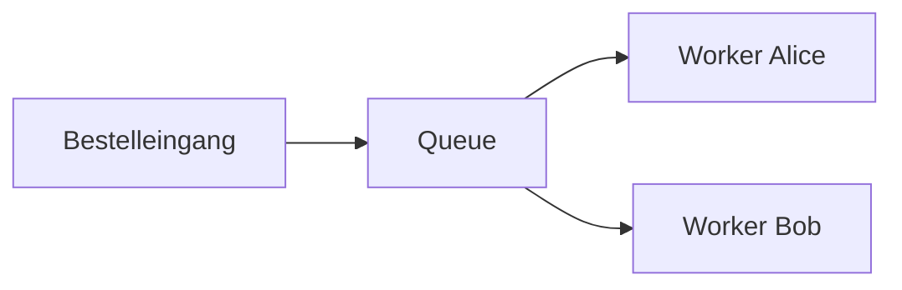
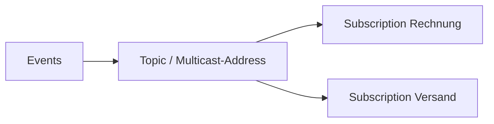

# Messaging Schritt für Schritt

## Warum asynchron?

Ein Onlineshop nimmt eine Bestellung an. Rechnung und Versand können später folgen, obwohl der Versandservice gerade offline ist. Eine Nachricht bleibt beim Broker gespeichert. Lastspitzen müssen dadurch nicht sofort von jedem Service verarbeitet werden. Der Kunde sieht zunächst „angenommen“, später „versandbereit“: Datenstände gleichen sich zeitversetzt an (**Eventual Consistency**). Das bringt zusätzliche Zustände, Wartezeiten, Fehlerbehandlung und mögliche Duplikate mit sich. Experiment: S01 ohne Worker senden, dann den Worker starten.

| Begriff | Beispiel | Beobachtung |
|---|---|---|
| Producer | Bestelleingang | S01 `produce` erzeugt JSON-Nachrichten |
| Broker | separater Artemis-Prozess | bleibt aktiv, wenn Producer beendet ist |
| Consumer | Versandworker | meldet RECEIVE und COMMIT |
| Nachricht | OrderCommand | fachliche ID plus Header und Properties |
| Queue | orders.incoming | zwei Worker teilen die Arbeit (S02) |
| Topic | orders.events | unabhängige Subscriptions bekommen Kopien (S03) |
| Subscription | shipping | hält die Sicht eines Interessenten auf ein Topic (S04) |





## Queue, Topic und Artemis-Speicher

Eine **Address** ist der Routing-Eingang in Artemis. Eine **Queue** speichert Zustellungen. Das Topic wird auf eine Multicast-Address abgebildet; die Subscriptions besitzen dahinter Artemis-Queues. Topic und Artemis-Queue schließen einander deshalb nicht aus.

| Jakarta Messaging | Artemis | Experiment |
|---|---|---|
| Queue | Anycast-Address mit Queue; eine Nachricht geht an eine passende Queue | S02, zwei Worker |
| Topic | Multicast-Address mit Queue pro Subscription | S03, beide Services |
| Durable Subscription | dauerhafte Subscription-Queue an Multicast-Address | S04, offline senden |
| Shared Durable Subscription | mehrere Consumer an derselben dauerhaften Subscription-Queue | S14, geteilte Kopie plus Audit-Kopie |

Eine Queue mit zwei Consumern liefert im fehlerfreien kontrollierten Lauf jeden Auftrag an einen von ihnen. Zwei **separate** Topic-Subscriptions erhalten jeweils eine Kopie. Innerhalb einer **Shared** Subscription teilen Worker wiederum die Arbeit. Fairness bedeutet keine exakte Hälfte oder strikte Abwechslung.

## API, Bibliothek und Protokoll

**Jakarta Messaging** ist die Java-API, früher **Java Message Service (JMS)**. Header wie `JMSMessageID` behalten historische Namen. Dieses Lab verwendet durchgehend `jakarta.jms`; `javax.jms` gehört zur älteren API-Namenswelt. Die Artemis-Jakarta-Clientbibliothek implementiert die API. Auf dem Netz spricht sie hier das Artemis-**CORE-Protokoll** über TCP beziehungsweise TLS. Die Java-API ist kein Netzwerkprotokoll. Andere Protokolle sind mögliche nächste Schritte, kein zusätzlicher Pflichtclient im Lab.

## Payload und Properties

[OrderCommand](../common/src/main/java/de/jumpstart/OrderCommand.java) und [OrderCreated](../common/src/main/java/de/jumpstart/OrderCreated.java) enthalten `schemaVersion`, eine stabile fachliche ID, `orderId`, `amountCents` und einen ISO-Zeitstempel. [Messages.create](../common/src/main/java/de/jumpstart/Messages.java) erzeugt TextMessage-JSON und passende Properties zusammen:

```java
m.setStringProperty("eventType",type);
m.setStringProperty("region",region);
m.setStringProperty("priorityClass",priority);
```

Die Properties lassen sich mit `region = 'EU'` filtern. Ein Selektor verwendet die Messaging-Selektorsprache mit Properties/Headern, keine Java-Prädikate und keine automatische Abfrage von JSON-Feldern. S07 zeigt vorhersagbare Mengen: bei sechs Events sind 1, 3, 5 EU; 3 und 6 sind Stornierungen. Eine JMSMessageID identifiziert einen technischen Send-Vorgang; eine fachliche ID bleibt beim Replay oder erneuten Senden erhalten. S09 zeigt verschiedene JMSMessageIDs mit derselben fachlichen ID. Keine ObjectMessages oder Java-Objektserialisierung verwenden.

## Acknowledgement, Transaktion und Geschäftsverarbeitung

**Receive** bedeutet noch nicht „fachlich erfolgreich“. Bei einer transacted Session bestätigt `commit()` die empfangenen Nachrichten und veröffentlicht die in dieser Session gesendeten Nachrichten atomar gegenüber demselben Broker. `rollback()` nimmt beides zurück. S08 prüft den Eingang und Ausgang. Eine Session gehört einem Worker; Session/JMSContext nicht ungesichert zwischen Threads teilen.

- `AUTO_ACKNOWLEDGE`: bei synchronem Empfang nach erfolgreicher Rückkehr aus `receive`, beim Listener nach erfolgreicher Rückkehr aus `onMessage`. Ein späterer Fehler in der Anwendung ist damit nicht automatisch abgesichert.
- `CLIENT_ACKNOWLEDGE`: `message.acknowledge()` bestätigt **alle bisher in dieser Session konsumierten Nachrichten**, nicht nur das einzelne Objekt. `recover()` ermöglicht Wiederzustellung noch unbestätigter Zustellungen; es ist keine fachliche Kompensation.
- `SESSION_TRANSACTED`: explizites Commit/Rollback; das ist der Standard der Lab-Worker. Der Acknowledgement-Mode-Parameter ist für transacted Sessions ohne eigene Wirkung.

S05 rollt eine Zustellung zurück oder beendet den Client vor dem Commit. Danach sind `JMSRedelivered` und, sofern verfügbar, `JMSXDeliveryCount` sichtbar. Ein fehlender Zähler wird als „unbekannt“ ausgegeben, niemals erfunden. **At-least-once** bedeutet mögliche Wiederzustellung; ein einzelner zuständiger Consumer je Zustellung garantiert keinen einmaligen Geschäftseffekt. ACK und fachlicher Erfolg sind unterschiedliche Entscheidungen.

## Drei verschiedene Arten von Dauerhaftigkeit

| Eigenschaft | Bedeutung | Experiment |
|---|---|---|
| persistente Message | Broker soll bestätigten Send dauerhaft speichern | S15 über Neustart |
| dauerhafte Queue | Queue existiert auch ohne Consumer und nach Neustart | S01/S15 |
| durable Subscription | Interessent bleibt registriert, während er offline ist | S04 |

Ein erstmals angelegter Subscriber kann keine beliebige Vergangenheit zurückholen. Erst registrieren, dann offline senden. Für das Neustartexperiment zusätzlich persistente Events und persistente Brokerkonfiguration verwenden. Das NIO-Journal ist explizit eingeschaltet; das Lab behauptet keinen umfassenden Stromausfallsicherheitstest.

## Fehler, Retry und Expiry

Ein **Retry** ist ein weiterer Versuch nach einem fehlgeschlagenen Zustellversuch. S06 erlaubt **drei Gesamtversuche = zwei zusätzliche Retries**, mit jeweils 500 ms Redelivery-Delay. Ein wachsender Backoff kann Systeme bei längeren Störungen entlasten; im Lab bleibt der Faktor bewusst 1. Ein transienter technischer Fehler kann nach Retry verschwinden. Eine fachlich ungültige Nachricht wird durch bloßes Warten nicht gültig. Nach dem Limit landet sie in einer expliziten **Dead Letter Queue (DLQ)**. Beim bewussten Replay wird im Beispiel die ungültige `priorityClass` in Payload und Properties repariert, die fachliche ID bleibt gleich. Nach Fehleranalyse keine endlose Retry-Schleife bauen.

**Expiry** ist davon unabhängig: S11 lässt die Lebensdauer (TTL) einer Nachricht ohne Consumer ablaufen. Sie geht zur Expiry-Queue, ohne dass der Worker dreimal scheitern musste. Fehler-/Expiry-Queues werden pro Quelladdress angelegt. Sie werden über FQQN (`Address::Queue`) angesprochen. S12 benutzt `MessageProducer.setDeliveryDelay()` für die erste Verfügbarkeit; das ist etwas anderes als ein Redelivery-Delay nach einem Fehler.

## Idempotenz und atomarer lokaler Effekt

S09 speichert eine fachliche ID als Primärschlüssel **in derselben H2-Transaktion wie den lokalen Ledger-Effekt**. [Ledger.apply](../lab/src/main/java/de/jumpstart/Ledger.java) führt einen INSERT und DB-Commit aus. `WRITE_DELAY=0` erzwingt unmittelbares Schreiben vor dem absichtlichen harten Prozessabbruch. Der INSERT enthält selbst den simulierten Buchungseffekt; es gibt kein getrenntes, möglicherweise vergessendes „bereits gesehen“-Set. Ein doppelter Schlüssel wird nach Rollback als Duplikat erkannt.

Crash nach DB-Commit und vor JMS-Commit: nach dem Neustart wird erneut zugestellt, die DB erkennt die ID, der Worker holt den JMS-Commit nach. Ein Java-Set verliert seinen Inhalt beim Neustart. Zwei separate DB-Operationen ohne gemeinsame Transaktion lassen eine Crashlücke. H2 läuft ausschließlich eingebettet für diese Vertiefung; die anderen Übungen rufen es nicht auf.

Diese Sicherheit gilt für den **lokalen DB-Effekt**. Eine echte Zahlung oder E-Mail wird dadurch nicht automatisch idempotent. JMS- und Datenbanktransaktion sind getrennt; es wird kein XA und keine verteilte Transaktion behauptet. **Inbox** und **Outbox** sind nächste Schritte: fachliche Änderungen und Verarbeitungseingang beziehungsweise ausgehender Sendeauftrag werden zusammen in einer DB gespeichert; ein separater Dispatcher verarbeitet die Outbox. Auch dabei brauchen Empfänger Duplikatbehandlung.

## Reihenfolge, Gruppen, Last und Priorität

Parallele Consumer können verschieden schnell abschließen. Logreihenfolge zwischen JVMs ist kein verlässliches globales Zeitmaß. S13 setzt `JMSXGroupID = orderId`; im kontrollierten Lauf bleiben die Events einer Order bei demselben Worker und erscheinen in Sendereihenfolge. Absturz, neue Gruppenzuordnung und ungesicherte Parallelverarbeitung begrenzen diese Aussage. Globale Reihenfolge über alle Orders folgt daraus nicht.

`priorityClass` ist hier eine fachliche Property, keine Anweisung zur JMS-Priorität. Technische Priorität könnte Auswahl beeinflussen, garantiert aber weder Fairness noch einen vollständigen Vorrang bei bereits ausgelieferten Nachrichten. S16 erzeugt höchstens 1000 kleine Aufträge pro Produce-Aufruf und macht den Rückstau mit einem langsamen Consumer sichtbar. Paging ab 1 MiB pro Address, 256-KiB-Seiten, global 64 MiB und synchrones Senden begrenzen den Trainingsbetrieb; Plattenplatz bleibt endlich. `consumerWindowSize=0` fordert Nachrichten bedarfsgesteuert an. Größere Fenster/Prefetch können Arbeit bereits vorab einem Consumer zuweisen und die beobachtete Verteilung verändern.

## Request/Reply

S10 setzt `JMSReplyTo` auf eine temporäre Queue. Der Antwortdienst setzt `JMSCorrelationID` auf die `JMSMessageID` des Requests. Nach Empfang prüft der Aufrufer diese Zuordnung und die Frist. Die Reply-Queue lebt nur mit der erzeugenden Verbindung und wird explizit gelöscht. Ohne Antwortdienst endet der Aufruf mit Timeout; der bereits bestätigte Request kann noch in der Eingangsqueue liegen. Spätere Antworten haben dann kein lebendes Antwortziel mehr. [Replies](../common/src/main/java/de/jumpstart/Replies.java) nutzt wenige ausdrücklich benannte Artemis-Aufrufe, damit auch temporäre Adressen im autorisierten Namespace liegen; die eigentlichen Send/Receive-Aufrufe bleiben Jakarta Messaging.

## Einordnung anderer Systeme

Auf Konzeptebene: SQS dient der gepufferten Arbeitsverteilung; SNS dient der Verteilung an mehrere abonnierte Ziele. Ein SNS-Topic mit mehreren SQS-Queues kann gepufferten Fan-out ausdrücken. Google Cloud Pub/Sub verbindet Topics mit unabhängig konsumierenden Subscriptions. Artemis bietet diese Queue-/Subscription-Konzepte als selbst betriebener Broker mit mehreren Protokollen. Daraus folgt weder API-Gleichheit noch eine direkte Entsprechung von SQS Visibility Timeout und jeder JMS-Acknowledgement-Art. Dieses Lab macht bewusst keine versionsabhängigen Cloud-Detailaussagen. Vergleicht nach S03 nur: Wo entsteht die Kopie, wo wartet die Arbeit, und wer bestätigt sie?

Weiterführende Experimente: Reconnect/Failover mit gezielten Unterbrechungen, Inbox/Outbox mit echtem Geschäftsmodell und andere Protokolle. Cluster, HA, XA und produktive Zahlungs-/Outbox-Infrastruktur gehören nicht zum Umfang.
