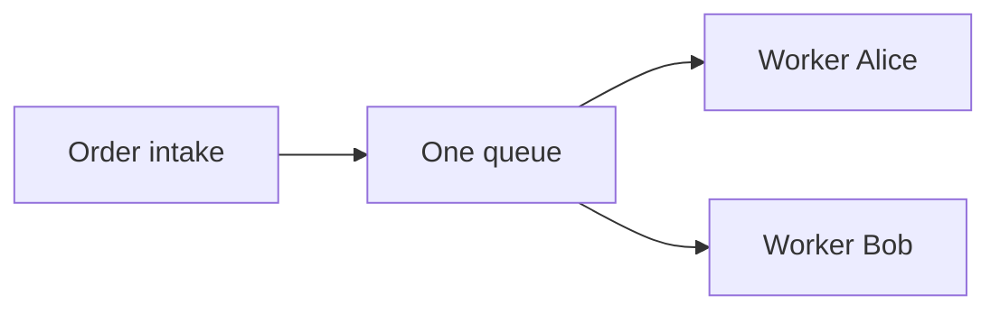
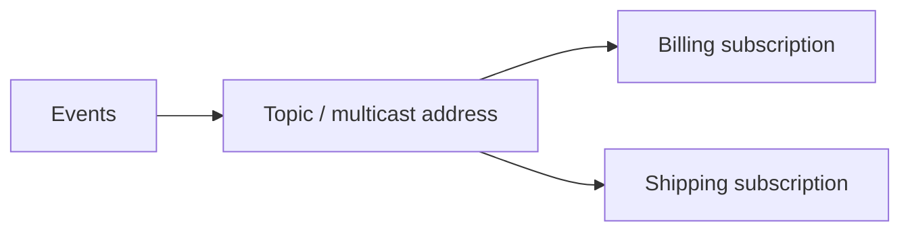

# Messaging step by step

## Why asynchronous work?

A shop accepts an order while shipping is offline. A broker can retain the command so a worker processes it later. Services do not all have to absorb a traffic peak at once. A customer first sees “accepted”, later “ready to ship”: views converge over time (**eventual consistency**). This adds waiting states, failure handling and possible duplicates. Try S01 without a worker, then start one.

| Term | Example | Evidence |
|---|---|---|
| Producer | Order intake | S01 produce sends JSON messages |
| Broker | Separate Artemis JVM | Remains active after producer exits |
| Consumer | Shipping worker | Logs RECEIVE and COMMIT |
| Message | OrderCommand | Business ID, payload, headers and properties |
| Queue | orders.incoming | Workers share work in S02 |
| Topic | orders.events | Independent subscriptions receive copies in S03 |
| Subscription | shipping | One interest in a topic, optionally durable in S04 |

## Addresses, queues and subscriptions

An Artemis **address** is the routing entry point. A **queue** stores deliveries. A Jakarta topic maps to a multicast address with a queue behind each subscription. These terms describe different layers.

| Jakarta Messaging | Artemis | Experiment |
|---|---|---|
| Queue | Anycast address with queue | S02, two workers share |
| Topic | Multicast address, queue per subscription | S03, two complete copies |
| Durable subscription | Subscription queue survives disconnection | S04, offline events |
| Shared durable subscription | Multiple consumers share one durable subscription queue | S14, shared team and independent audit |

In a controlled failure-free run, workers on one queue share each command. Independent topic subscriptions each receive their own copy. Workers inside one shared subscription share its copy. Neither exact halves nor strict alternation are guaranteed.

## API, library and protocol

**Jakarta Messaging** is the Java API, formerly **Java Message Service (JMS)**. Header names such as `JMSMessageID` retain that history. This lab uses `jakarta.jms` throughout; `javax.jms` belongs to the earlier API namespace. The Artemis Jakarta client implements the API. Here it communicates using the Artemis **CORE protocol** over TCP or TLS. The Java API is not a network protocol.

## Payload, properties and identity

[OrderCommand](../common/src/main/java/de/jumpstart/OrderCommand.java) and [OrderCreated](../common/src/main/java/de/jumpstart/OrderCreated.java) contain `schemaVersion`, a stable business ID, `orderId`, `amountCents` and an ISO timestamp. [Messages.create](../common/src/main/java/de/jumpstart/Messages.java) creates JSON TextMessage bodies and consistent `eventType`, `region` and `priorityClass` properties.

A selector such as `region = 'EU'` uses the messaging selector language over properties/headers. It is neither a Java predicate nor an automatic JSON query. S07 sends six events: orders 1,3,5 are EU; 3,6 are cancellations. Do not use ObjectMessage or Java object serialization.

`JMSMessageID` identifies a technical send; the business ID remains stable across replay or deliberate resend. S09 demonstrates distinct technical IDs with one business ID. `priorityClass` is a business property here, not JMS priority. Technical priority would not guarantee fairness or preempt work already delivered.

## Acknowledgement and business processing

Receive does not mean business success. In a **transacted session**, `commit()` confirms received messages and publishes messages sent in that session atomically against the same broker; `rollback()` reverses both. See S08. Each worker owns its connection/session; do not share a Session or JMSContext unsafely between threads.

- `AUTO_ACKNOWLEDGE`: synchronous delivery is acknowledged after receive returns successfully; a listener delivery after onMessage returns successfully. Later application failure is not automatically protected.
- `CLIENT_ACKNOWLEDGE`: message.acknowledge() confirms **all messages consumed so far in that session**, not just that object. recover() permits redelivery of unacknowledged deliveries, not business compensation.
- `SESSION_TRANSACTED`: explicit commit/rollback, the lab worker default. The acknowledgement-mode parameter has no separate effect on a transacted session.

S05 rolls back or crashes before JMS commit. Compare the same business ID, `JMSRedelivered` and available `JMSXDeliveryCount`. An unavailable count prints `unknown`; it is never invented. At-least-once delivery permits redelivery. One responsible consumer per delivery does not imply a once-only business effect.

## Three kinds of durability

| Property | Meaning | Experiment |
|---|---|---|
| Persistent message | Confirmed send should be stored durably | S15 restart |
| Durable queue | Queue survives absent consumers and restart | S01/S15 |
| Durable subscription | Registered interest remains while offline | S04 |

A newly created subscription cannot recover arbitrary history. Register first, then send while offline. Restart experiments also use persistent events and the explicitly persistent NIO journal. This lab does not establish comprehensive power-loss resilience.

## Retry, dead letters and expiry

A retry is another attempt after failed delivery. S06 permits **three total attempts = two additional retries**, with a 500 ms redelivery delay and multiplier 1. Increasing backoff can reduce pressure during longer outages. A transient technical fault may disappear; invalid business data does not become valid by waiting.

After the attempt limit, the message enters a **dead letter queue (DLQ)** for investigation. Deliberate replay repairs `priorityClass` in both payload and properties, preserves the business ID and creates a new technical send. Do not hide invalid work in an infinite retry loop.

Expiry is independent: S11 lets TTL expire without a worker failure. Per-source error/expiry queues are accessed using a fully qualified queue name (FQQN), `Address::Queue`. S12 uses MessageProducer.setDeliveryDelay for first availability, distinct from redelivery delay after failure.

## Idempotency and one local atomic effect

S09 uses a business ID primary key **in the same H2 transaction as the local ledger effect**. [Ledger.apply](../lab/src/main/java/de/jumpstart/Ledger.java) inserts the ID, order and amount in one row, then commits. `WRITE_DELAY=0` writes before the deliberate hard crash. A unique-key violation is handled specifically after DB rollback; other SQL errors are not silently treated as duplicates.

After DB commit but before JMS commit, a crash causes redelivery. Recovery recognizes the ID and completes JMS commit without repeating the local effect. An in-memory Set loses its state on restart. Separate ID/effect commits leave a crash gap. H2 is embedded only for this extension.

This protects the **local DB effect**, not an external payment or email automatically. JMS and DB transactions remain separate; no XA/distributed transaction or end-to-end exactly-once guarantee is claimed. Inbox/outbox patterns store business changes together with an incoming record or outgoing send request in one DB transaction; a dispatcher sends outbox work. Receivers still need duplicate handling.

## Order, groups and bounded load

Parallel consumers can finish at different speeds; cross-JVM log order is not a global clock. S13 uses `JMSXGroupID = orderId`: in the controlled run one worker sees sequence 1,2,3 per order. Crashes, reassignment and unsafe application parallelism limit that observation. It is not global order across all orders.

S16 produces at most 1000 small orders per invocation. Paging starts at 1 MiB/address with 256 KiB pages and a 64 MiB global limit; disk space is still finite. Sends are persistent, synchronous and time-bounded; producer credit window is -1 to avoid unbounded credit waits. `consumerWindowSize=0` requests work on demand. Prefetch can reserve work in advance and change distribution.

## Request/reply

S10 sets JMSReplyTo to a temporary queue. The responder sets JMSCorrelationID to the request JMSMessageID; the caller checks correlation and timeout. The queue lives with its creating connection and is explicitly deleted. Without a responder the caller times out; a committed request can remain after its reply target disappears. [Replies](../common/src/main/java/de/jumpstart/Replies.java) uses a few explicit Artemis calls to keep temporary addresses within the authorized namespace; send/receive still use Jakarta Messaging.

## Relating the concepts

At a conceptual level, SQS buffers shared work; SNS distributes to subscribed destinations, and SNS with multiple SQS queues can provide buffered fan-out. Google Cloud Pub/Sub has topics with independent subscriptions. Artemis provides queue/subscription concepts as a self-operated broker with multiple protocols. This is not API equivalence or a direct mapping of SQS visibility timeout to every JMS acknowledgement mode. Compare: where is the copy created, where does it wait, and who confirms it?

Reconnect/failover, inbox/outbox and other protocols are possible extensions. Clustering, HA, XA and production payment infrastructure are outside this lab.
